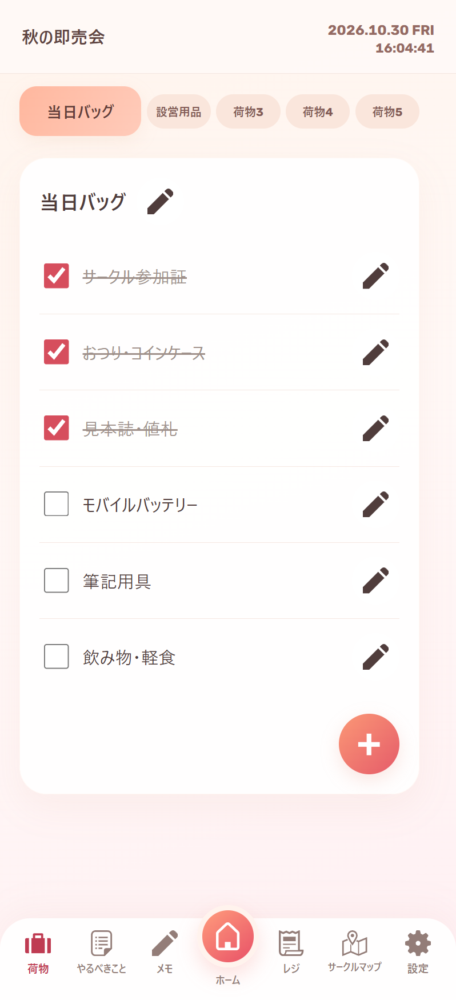
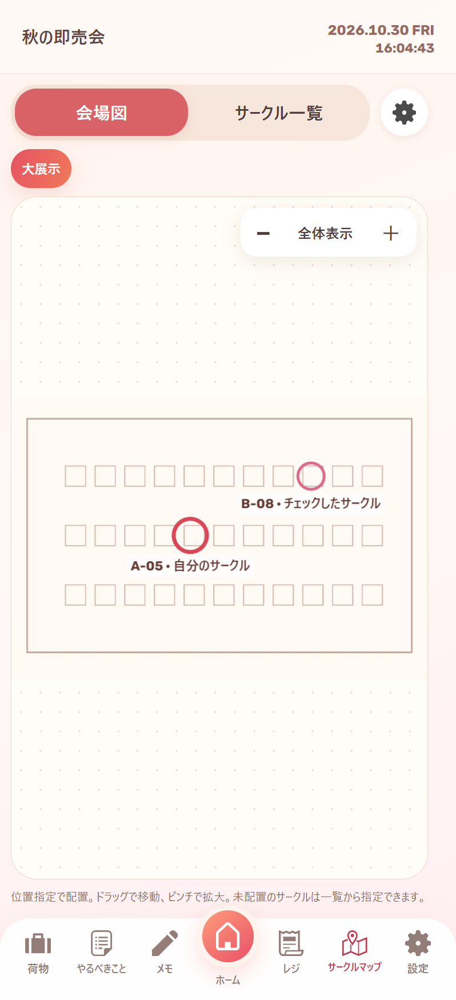
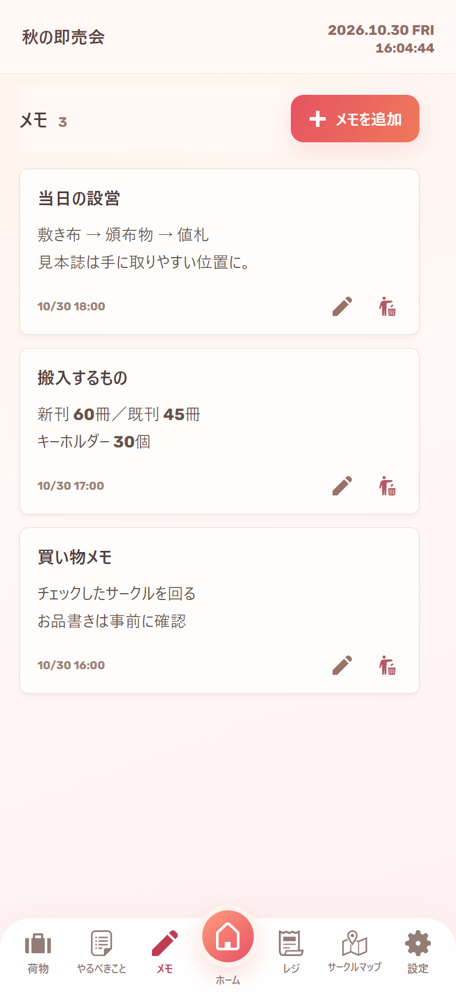

# サークルづくり

**BESTIA WORKS Apps / 同人イベントの荷物・予定・会計・マップを管理するAndroidアプリ**

荷造り、やること、当日の予定、レジ・在庫をイベントごとに管理できます。BESTIA WORKSが制作するアプリのひとつです。

[紹介ページ・画面・使い方](https://riotaro015.github.io/circle-prep/) · [APKをダウンロード](https://github.com/riotaro015/circle-prep/releases/download/v0.1.6/circle-prep-0.1.6.apk) · [更新履歴](https://github.com/riotaro015/circle-prep/releases) · [BESTIA WORKS](https://bestiaworks.com/)

画面例は架空のイベント・商品・会場図を使用しています。機能・導入方法・詳しい仕様は[紹介ページ](https://riotaro015.github.io/circle-prep/)にまとめています。

## お品書きだけを閲覧

[野郎フェス2026 お品書き一覧](https://riotaro015.github.io/circle-prep/menus/)は、アプリ不要で検索・画像拡大・商品価格の確認ができます。商品ごとの数量・購入済みと合計金額をまとめる買い物リストも利用できます。チェック・買い物リストはブラウザー内に保存します。追加・訂正リクエストはページ内フォームからGitHubへ送れます（ログインが必要・公開投稿）。

画像を含むオフライン保存と、[ZIPを展開してHTMLを開くだけのオフライン版](https://github.com/riotaro015/circle-prep/releases/download/v0.1.6/yaroufes-2026-menus-offline.zip)にも対応しています。

## ダウンロード

[Releases](https://github.com/riotaro015/circle-prep/releases) で Android版APKとSHA-256チェックサムを配布しています。各版の変更内容もこちらに掲載します。

このリポジトリはアプリの紹介・配布・利用案内用です。開発用ソースコードは含みません。

## できること

- イベントの新規作成と切り替え
- 遠征・近場・空の状態から選ぶ荷物のひな形
- バッグ別の持ち物・荷造りチェック、長押し／ドラッグで並べ替え・削除
- やることリストとタイムライン
- 商品・在庫・現金会計・売上記録の管理
- 画像・PDFの会場図登録、ページ選択、複数マップ、ペン・蛍光ペン・図形・文字の書き込み
- 会場図／サークル一覧のタブ、移動・折り畳みできる一覧ウィンドウ、検索とチェック済みフィルター
- 野郎フェスのお品書き・商品情報と同梱画像のオフライン表示。登録済みイベントにも個人の記録を保って取り込み
- サークル行全体でのチェックと大きな詳細ボタン、歯車メニューに集約した操作
- 自分のサークル番号入力、位置と大きさを変えられる丸枠、おしながき・買い物メモ
- 登録状況に応じたSTEP案内と、日本語・英語・韓国語・簡体字・繁体字の画面
- イベント別のカード式メモと保存データ量の目安
- 記録のファイル書き出しと復元

## Android版の導入

Android 8.0以上が対象です。現在の配布版はテスト版です。

1. Releasesから `.apk` ファイルをダウンロードします。
2. ファイルを開き、Androidの案内に従ってインストールします。必要に応じて、ダウンロードに使ったブラウザなどの「この提供元のアプリを許可」を設定します。
3. 「サークルづくり」を起動し、イベントを作成するか、同梱のイベントデータを選びます。

更新するときは、先に設定からバックアップを書き出し、新しいAPKを上書きインストールしてください。既存アプリをアンインストールすると端末内の記録が消えます。

**公開テスト版：0.1.6**。実機での確認は継続中です。

この版を入れた後は、設定の「最新版に更新」で最新版の確認・APK取得・検証・Android標準の更新画面まで進めます。最後のインストール確認と、必要な初回の提供元許可はAndroidで行います。APKやGitHubのAssetsを手で選ぶ必要はありません。

旧版から今回の版への更新は、一度だけReleasesからAPKを保存して開くか、旧版の設定からAPKを選んでください。新しいアプリは、同じアプリID・署名で上書きします。古い公開版へは戻しません。手動更新の入口も残しています。

## マップとイベントデータ

野郎フェス2026-autumn-の公開サークル一覧と、大展示・小展示の配置図を収録しています。対応する配布イベントにだけ取り込み、既存の利用者登録マップを上書きしません。操作確認用マップの生成機能は削除しました。

利用者が別の画像やPDFを登録することもできます。PDFは10MB・200ページ以下、マップはイベントごとに最大6つです。選んだページを会場図として画像化し、PDF原本も端末内に保存します。サークルの位置指定は利用者が行います。

配布イベントは取得日を基準に、開催予定・開催日未定・過去開催へ分けて表示します。過去開催は折り畳んで選択できます。入場時刻や搬入条件は、主催者の最新案内をご確認ください。

## 記録と通信

Android版は画面・フォント・イベントデータを同梱し、通常の操作はオフラインで使えます。更新ボタンを押した際にGitHubへ接続して、最新版を確認・取得します。記録をサーバーへ送信しません。ログインやクラウド同期はありません。

取得したAPKはハッシュ・アプリID・署名・バージョンを確認し、Android標準インストーラーへ渡します。配布ページを外部ブラウザーで開くこともできます。メモ・マップ画像・おしながきも端末内で保存し、全体バックアップに含めます。イベントに表示する容量は、保存データの目安であり、アプリ全体のディスク使用量ではありません。

記録は端末内に保存されます。機種変更やアプリ削除の前にバックアップを書き出し、端末外にも保管してください。同梱イベント情報は収録時点のものです。参加時は主催者の最新案内を確認してください。

## ご案内・フィードバック

イベント主催者の公式アプリではありません。不具合や要望は [Issues](https://github.com/riotaro015/circle-prep/issues) へどうぞ。端末名・Androidバージョン・アプリの版・再現手順があると確認しやすくなります。売上記録や個人情報を含むバックアップは公開しないでください。

制作：**BESTIA WORKS**  
公式サイト：[bestiaworks.com](https://bestiaworks.com/)

本リポジトリでの配布は、アプリや素材の再配布・改変の許諾を意味しません。第三者素材の利用条件は各権利者の定めに従います。
